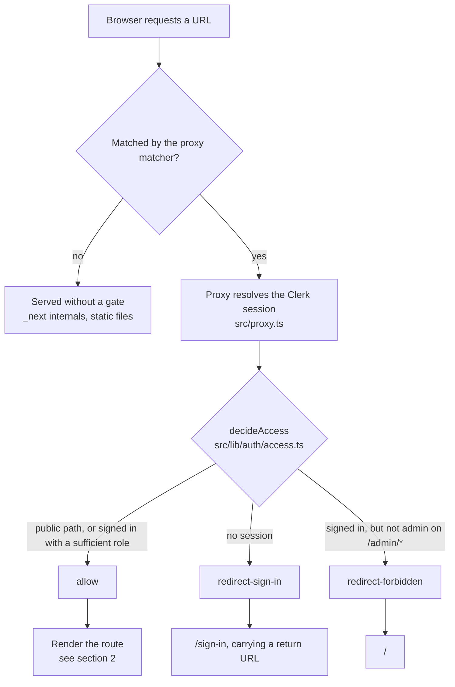
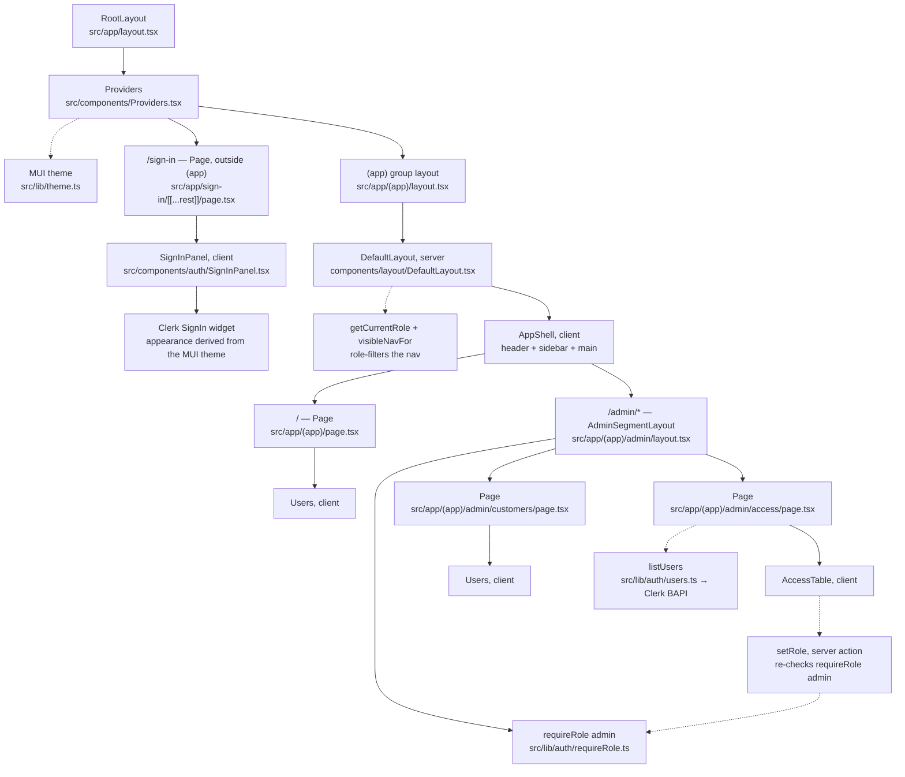
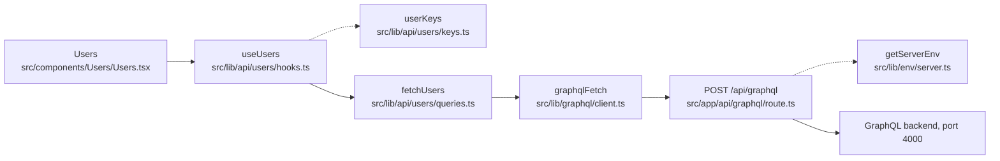

# Auth and component flow

How a request becomes a screen in this frontend: what runs, what the user sees,
and which file to open. Every visitor passes the same gate before any component
renders.

Paths are relative to `frontend/`.

---

## 1. The gate

Runs on every matched request, before any rendering.



Two things are deliberate here:

- **`src/proxy.ts` holds no rules.** It resolves the session and translates a
  decision into a response. All policy lives in `src/lib/auth/access.ts` as a
  pure function, which is why it can be tested without Next or Clerk in the way.
- **An unauthenticated request to `/admin/*` goes to sign-in, not to forbidden.**
  A signed-out visitor shouldn't learn that an admin route exists.

Next.js 16 renamed middleware to *proxy*; `src/proxy.ts` is the former
`middleware.ts`.

---

## 2. The render tree

`RootLayout` and `Providers` wrap every route. Providers nest outside-in: Clerk,
the MUI/Emotion cache for the App Router, TanStack Query, then the MUI theme and
`CssBaseline`.

Below that, the tree forks on **whether the route is inside the `(app)` route
group**. Inside, it gets the shared application chrome; outside, it renders bare.
`(app)` adds no URL segment — see [`layout.md`](./layout.md).



The dotted line from `setRole` back to `requireRole` is the point: the action
does not inherit the page's guard. It is reachable as its own POST endpoint, so
it repeats the check itself.

Note that `AdminSegmentLayout` is now **only a guard** — it calls `requireRole`
and renders its children. The chrome comes from the `(app)` group above it, so
there is no longer a separate admin layout component.

### Routes at a glance

| Route | Access | What renders | Entry file |
| --- | --- | --- | --- |
| `/sign-in` | Public — the only route reachable without a session | Clerk's widget centred in the viewport, restyled to the MUI theme. **No app chrome.** | `src/app/sign-in/[[...rest]]/page.tsx` |

`/sign-in` is an **optional catch-all** (`[[...rest]]`), and has to be. Clerk's
`<SignIn />` uses path-based routing and serves its own sub-routes — factor-one,
sso-callback, forgot-password — beneath `/sign-in`; as a plain `page.tsx` it
renders *"The `<SignIn/>` component is not configured correctly"*. The optional
catch-all still serves `/sign-in` itself, so `SIGN_IN_PATH` is unchanged, and
`PUBLIC_PATHS` already matches the whole subtree so the proxy lets the
sub-routes through.
| `/` | Any signed-in user; the role claim is not consulted | The user list inside the app layout | `src/app/(app)/page.tsx` |
| `/admin/customers` | `admin` only, checked at the proxy *and* in the segment layout | The MongoDB customer list inside the app layout, with Customers highlighted in the sidebar | `src/app/(app)/admin/customers/page.tsx` |
| `/admin/access` | `admin` only, at the proxy, the segment layout, **and** the page. The `setRole` action checks separately. | Every Clerk account with its role and a dropdown to change it; the signed-in admin's own row is locked | `src/app/(app)/admin/access/page.tsx` |

**Everything inside `(app)` renders dynamically**, because the group layout calls
both `auth()` and `cookies()` — so `/` is now dynamic too, where it used to be
static. `/sign-in` is dynamic as well, since converting it to an optional
catch-all means it can no longer be prerendered; it was static before that
change.

---

## 3. The data path behind the user list

`/` and `/admin/customers` render the same `Users` component, so both follow this
chain. The browser never talks to the GraphQL backend directly — it goes through
an internal route handler.

These are **MongoDB** records, not Clerk accounts. The component and hook keep
the `Users` name because the backend GraphQL type is `User`; the route is named
`customers` so it isn't mistaken for Clerk account management, which lives at
`/admin/access`.



| Step | File | What it does |
| --- | --- | --- |
| `useUsers` | `src/lib/api/users/hooks.ts` | TanStack Query hook; caches under the shared key factory |
| `userKeys` | `src/lib/api/users/keys.ts` | Cache keys — `["users"]` and `["users", id]` |
| `fetchUsers` | `src/lib/api/users/queries.ts` | Holds the GraphQL documents; types responses from the generated contract package |
| `graphqlFetch` | `src/lib/graphql/client.ts` | POSTs to `/api/graphql`, unwraps errors and the data envelope |
| Route handler | `src/app/api/graphql/route.ts` | Server-side forwarder to the real GraphQL server |
| `getServerEnv` | `src/lib/env/server.ts` | Zod-validates `GRAPHQL_SERVER` before forwarding |

---

## 4. Auth module index

| Module | File | Runs on | Responsibility |
| --- | --- | --- | --- |
| proxy | `src/proxy.ts` | Every matched request | Edge adapter — turns a decision into a response. No rules of its own. |
| `decideAccess` | `src/lib/auth/access.ts` | Every matched request | The entire policy, as a pure function. Also owns public and admin path matching. |
| roles | `src/lib/auth/roles.ts` | Policy and guards | Role vocabulary and safe claim parsing; unrecognised values resolve to no role. |
| `requireRole` | `src/lib/auth/requireRole.ts` | `/admin/*` layout | Resource-level guard for server components, so the segment stays protected if the matcher changes. |
| `getCurrentRole` | `src/lib/auth/requireRole.ts` | `(app)` group layout | Reads the role **without** redirecting, for deciding what to display. |
| Clerk accounts | `src/lib/auth/users.ts` | `/admin/access` page | The only module that calls Clerk's Backend API: lists accounts, writes a role. **No authorization of its own.** |
| `setRole` | `src/lib/auth/setRole.ts` | Server action (public POST) | The guarded entry point for a role change, and **the security boundary for it**. Re-checks `requireRole('admin')` every call. |
| Role-change vocabulary | `src/lib/auth/roleChange.ts` | Both sides | Result shape and messages. A separate file because a `'use server'` module may export only async functions. |
| Session claim types | `src/types/globals.d.ts` | Compile time | Declares the token's `metadata.role` shape — optional, because it is genuinely absent until configured. |

### Two role parsers, deliberately

`getRole` in `roles.ts` reads a **session claim**, where the metadata is nested
under a `metadata` key. `roleFromMetadata` in `users.ts` reads `publicMetadata`
straight off a Clerk account, with no such nesting. Neither accepts the other's
input, and a test pins that — feeding one the other's shape returns no role,
which would otherwise look like "this user has no role" rather than a bug.

### Writing a role is not the same as reading one

`requireRole` and `decideAccess` protect *routes*. They do not protect the
*mutation*: `setRole` is a server action, which compiles to a public POST
endpoint that any signed-in user can invoke directly with arguments of their
choosing. Its own `requireRole('admin')` call is what stops that, and it is not
a duplicate of the page's check. Any future role-mutating action needs the same.

### The layout also reads the role — for display only

`DefaultLayout` calls `getCurrentRole()` and filters the navigation with
`visibleNavFor(role)`. This is **presentation, not enforcement**: it hides links a
user shouldn't see, and does nothing to stop them reaching the URL directly.
Enforcement remains the proxy and `requireRole`. See
[`layout.md`](./layout.md#4-role-visibility).

Tests sit beside each module: `access.test.ts`, `roles.test.ts`,
`requireRole.test.ts`, `users.test.ts`, `setRole.test.ts`, `src/proxy.test.ts`,
`src/components/auth/SignInPanel.test.tsx`,
`src/components/access/AccessTable.test.tsx`, and the layout suite under
`src/components/layout/`. Run them with `pnpm test`.

---

## 5. Worth knowing before you edit

**Required Clerk Dashboard setup.** The role only reaches the proxy if Clerk
copies it into the session token. Add this session claim in the Dashboard:

```json
{ "metadata": "{{user.public_metadata}}" }
```

Without it, every role lookup returns nothing and `/admin/*` denies everyone,
including real admins. See [`auth.md`](./auth.md) for assigning roles.

**Where to add a rule.** New public route, new protected prefix, new role: edit
`src/lib/auth/access.ts`. The proxy and the layout guards both read from it, so
one edit covers the edge and the resource.

**Adding a nav entry is a separate, non-security change.** `NAV_SECTIONS` in
`src/lib/navigation/navigation.ts` controls what is *shown*. A new admin page needs
**both** a guard and a nav entry; adding the entry alone shows a link without
protecting it, and adding the guard alone protects a page nobody can find. See
[`layout.md`](./layout.md#3-adding-a-navigation-entry).

**Two constraints the test suite cannot enforce.** Both were found in the
browser or the build, never by `pnpm test`:

- **`'use server'` files may export only async functions.** A constant or a
  re-exported value fails the build with *"Only async functions are allowed to
  be exported in a 'use server' file"* — which is why `roleChange.ts` exists
  separately from `setRole.ts`. The trap: **a build only validates action files
  that something imports.** An unreferenced action compiles perfectly clean and
  breaks the moment a page uses it.
- **`/sign-in` must stay an optional catch-all** (`sign-in/[[...rest]]/`).
  Clerk's `<SignIn />` uses path routing and serves factor-one, sso-callback,
  and forgot-password beneath `/sign-in`. As a plain `page.tsx` it renders *"The
  `<SignIn/>` component is not configured correctly"* at runtime while passing
  every test.

**Client components that call a server action must keep a stable DOM shape.**
`setRole` calls `revalidatePath`, so Next replaces the page's subtree at the
moment the action resolves — while the caller's `setState` is landing. A node
inserted or removed in that tick can hit a parent React no longer owns, which
WebKit reports as `NotFoundError: The object can not be found here` from
`insertBefore`. `AccessTable` therefore mounts nothing in response to an action:
its Select children are a fixed list, the row spinner is always present and
toggles `visibility`, and feedback lives in one permanently mounted
`role="status"` region. **Add feedback by changing content, not by
conditionally rendering an element.**

**The backend is still open.** These gates protect pages and the internal API
route only. The GraphQL server has no token verification and remains directly
reachable on port 4000, so a signed-out client can still query it. Tracked as
the next task, not fixed here.

**No sign-up route.** Nothing serves `/sign-up`, so the widget's sign-up link
bounces back to sign-in. Create accounts from the Clerk Dashboard for now.

**Two route-group moves have happened — URLs did not change the second time.**
`/users` was once served by an `(admin)` route group whose parentheses added no URL
segment; it became genuinely `/admin/users`. Separately, `page.tsx` and `admin/`
later moved into an `(app)` group to pick up the shared layout — that move changed
**no** URLs, because `(app)` is also a group. Confirmed against the production
route table. The route has since been renamed again, to `/admin/customers`, this
time a real URL change.

**Defined but never imported.** Three files are unreferenced — left in place, but
don't assume they're wired in:

- `src/components/Users/UserDetail.tsx`
- `src/lib/providers/QueryProvider.tsx` — `Providers.tsx` has its own `QueryClientProvider`
- `src/lib/queries/orders.ts`

---

## Keeping this current

Nothing enforces that this file matches the code. Refresh it when routes,
component nesting, or the auth modules change.

It is also published as a rendered page at
<https://claude.ai/code/artifact/acc3b74a-bdf8-4f83-b12d-cc62af4b5e14>. To update
that page, republish this file with the URL above pinned as the target —
otherwise a new link is minted and the one above goes stale.
