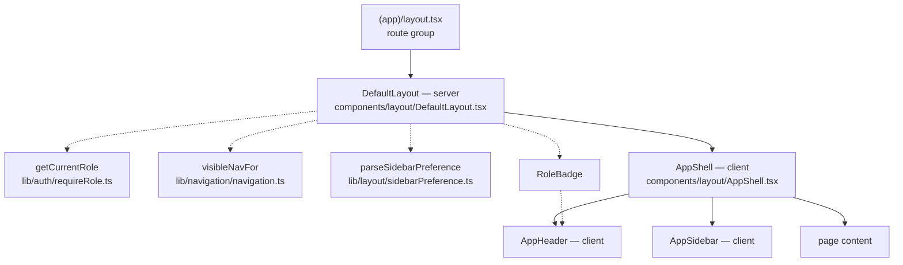

# Application layout

Every signed-in page renders inside one shared shell: a collapsible sidebar, a
header, and a content column. The sidebar entries and header items vary by the
signed-in user's role.

Paths are relative to `frontend/`.

---

## 1. Which routes get the chrome

The split is done with a **route group**, `src/app/(app)/`. Parentheses in an App
Router directory name contribute **no URL segment**, so `(app)/admin/users` still
serves `/admin/users`.

```
src/app/
├── layout.tsx          # Root — Providers only. No chrome.
├── (app)/              # ← everything in here gets the sidebar and header
│   ├── layout.tsx      #   renders DefaultLayout
│   ├── page.tsx        #   /
│   └── admin/          #   /admin/* (the admin guard lives here)
├── sign-in/            # ← outside the group: no chrome, full-bleed
└── api/graphql/        # route handler, renders nothing
```

**Add new pages inside `(app)/`.** Put a route outside the group only when it
genuinely should render without app chrome — a sign-in or sign-up screen, an
embed, a public landing page. `/sign-in` is outside deliberately: a signed-out
visitor should not be shown navigation they cannot use.

One consequence worth knowing: the group layout calls `auth()` and `cookies()`, so
**every page inside `(app)/` is server-rendered on demand** and cannot be
statically prerendered. That is the unavoidable cost of a role-aware layout.
`/sign-in`, outside the group, stays static.

---

## 2. The component stack



| Component | Runs on | Responsibility |
| --- | --- | --- |
| `DefaultLayout` | **Server** | The only auth-aware piece. Resolves the role, filters the nav, reads the sidebar cookie, chooses header actions. |
| `AppShell` | Client | Owns layout state: collapsed or expanded, mobile overlay open, the `[` shortcut. |
| `AppHeader` | Client | Toggle, title, breadcrumb, `actions` slot, Clerk user menu. |
| `AppSidebar` | Client | Renders the nav sections it is given. Does no filtering. |
| `RoleBadge` | — | Example of a per-user header item. |
| `navigation.ts` | Either | Pure nav registry and helpers. No React or Clerk imports. |
| `sidebarPreference.ts` | Either | Cookie read/write for the collapse preference. |
| `dimensions.ts` | — | Sidebar widths, shared so the rail and content offset cannot drift. |

Only `DefaultLayout` knows about authentication. Everything below it is
presentational and prop-driven, which is why each piece can be tested on its own.

---

## 3. Adding a navigation entry

Nav is data, not markup. Edit `NAV_SECTIONS` in
`src/lib/navigation/navigation.ts`:

```ts
{
  id: 'jobs',                 // stable key; also what tests reference
  label: 'Jobs',              // display text
  href: '/admin/jobs',        // omit entirely to make it a placeholder
  icon: PlayArrowIcon,        // a component reference, never JSX
  requiredRole: 'admin',      // omit for "any signed-in user"
}
```

Nothing else needs touching — the sidebar, the active highlight, and the
breadcrumb all derive from this.

### Placeholders, for pages that don't exist yet

**Omit `href`.** The entry still appears in its slot but renders disabled, is
removed from the tab order, and can never be the active item. Use
`PLACEHOLDER_ICON` until you have a real icon.

```ts
{ id: 'settings', label: 'Settings', icon: PLACEHOLDER_ICON, requiredRole: 'admin' }
```

This is what `Settings` currently is. Promoting it later means adding an `href`
and swapping the icon — no other change anywhere.

The alternative — a real `href` to an unbuilt route — gives you a sidebar that
looks finished and 404s when clicked.

### `exact`

A nav `href` matches its whole subtree, so `/admin/users` stays highlighted on
`/admin/users/42`. Set `exact: true` to match only the precise path. A root href
of `/` is **always** treated as exact, whether or not you set the flag — without
that, Dashboard would prefix-match every path in the app and always look active.

---

## 4. Role visibility

`DefaultLayout` calls `visibleNavFor(role)` before passing sections down, so a
non-admin's browser never receives the admin entries at all. Sections left empty
by filtering are dropped, so no orphan heading appears.

> ### Hiding a link is not protecting a route
>
> `requiredRole` on a nav item controls **visibility only**. It does not gate
> anything. A route with no nav entry, or one filtered out for this user, is still
> reachable by typing the URL.
>
> Access control lives in two other places, and adding a nav item does not touch
> either:
>
> - `src/proxy.ts` — at the edge, on every request
> - `requireRole` — at the resource, in the route's own layout
>
> When you add an admin page, add the guard **and** the nav entry. See
> [`auth.md`](./auth.md).

### Roles and the three outcomes

| Role in session token | Sees admin nav |
| --- | --- |
| `admin` | Yes |
| `user` | No |
| *absent or unrecognised* | **No** — fails closed |

The last row is not hypothetical. Until the Clerk Dashboard session claim is
configured, **every** account reads as role-less and the admin nav is empty for
everyone. That is why `RoleBadge` renders an explicit amber `no role` chip rather
than nothing: an empty sidebar with no explanation looks like a bug, and the chip
names the cause. See
[`auth.md`](./auth.md#required-clerk-dashboard-setup).

---

## 5. Per-user header items

`AppHeader` takes an `actions` slot and makes no decisions about it.
`DefaultLayout` decides what goes in, the same way it decides which nav sections
to pass:

```tsx
// src/components/layout/DefaultLayout.tsx
actions={<RoleBadge role={role} />}
```

To add a control only admins see, compose it there — not inside `AppHeader`, which
stays presentational:

```tsx
actions={
  <>
    {role === 'admin' && <DeployButton />}
    <RoleBadge role={role} />
  </>
}
```

The same caveat as section 4 applies: this hides a *control*, it does not protect
whatever the control calls. Guard the action itself too.

---

## 6. Sidebar behaviour

**Collapse persists in a cookie** (`sidebar_open`), not `localStorage`. The server
reads it in `DefaultLayout` and passes `defaultOpen`, so the sidebar renders at its
stored width on the **first paint**. `localStorage` is only readable after mount,
which would mean a visible snap from expanded to collapsed on every page load.

The cookie is `SameSite=Lax`, `path=/`, one-year max-age, and deliberately has **no
`Secure` flag** — that would stop it working on `http://localhost`, and a sidebar
width is not sensitive. Any unrecognised value falls back to expanded, so a corrupt
cookie cannot collapse the layout or throw.

**`[` toggles the sidebar**, matching the convention in editors and IDEs. It is
ignored when combined with ctrl/cmd/alt, and while focus is in an input, textarea,
select, or contenteditable — otherwise typing `[` into a search box or a JSON field
would collapse the layout.

**Responsive.** At `md` and above, a permanent rail that collapses from 248px to a
72px icon-only strip; collapsed rows keep an accessible name and show their label
on hover. Below `md`, the rail is hidden and the toggle opens a temporary overlay
instead, which closes itself after you navigate. Overlay state is **not** persisted
— it is transient, not a preference.

Both drawers are always rendered, with the rail hidden by CSS rather than
unmounted. Branching on a media query during render would cause either a hydration
mismatch or a visible sidebar pop-in. `useMediaQuery` is therefore used only inside
the toggle handler, never to decide what to render.

---

## 7. Testing notes

```bash
pnpm test
```

Three kinds of coverage, deliberately separated:

- **`navigation.test.ts`** — the pure registry and helpers, driven with fixtures
  rather than the real nav.
- **Component tests** — `AppSidebar`, `AppHeader`, `AppShell`, `RoleBadge` in
  isolation. `DefaultLayout.test.tsx` mocks `AppShell` to assert what the layout
  *decides*.
- **`DefaultLayout.integration.test.tsx`** — composes the real tree with only
  external boundaries stubbed, to catch pieces that pass their own tests but fail
  to assemble.

Two harness facts that will cost you time otherwise:

- **jsdom does not evaluate `@media` queries.** The CSS-hidden desktop rail is
  still in the DOM during the mobile tests, which is why those assertions are
  scoped to the overlay (`role="presentation"`). **The responsive `display` rules
  are not covered by any test** — they need a real browser.
- MUI marks the permanent Drawer's root **`MuiDrawer-docked`**, not
  `MuiDrawer-permanent`.

`window.matchMedia` has no jsdom implementation and is stubbed per test; without
that, every test silently runs the mobile branch.

---

## 8. Known gaps

- **Nothing has been verified in a real browser.** The layout is covered by tests
  and its markup checked server-side, but no one has looked at it at any viewport.
  The responsive rules in particular are untested.
- **`/` and `/admin/users` render the same user list.** `(app)/page.tsx` is still a
  verbatim copy of the admin users page, so the two routes look identical inside
  identical chrome. `/` wants a real landing page.
- **The nav registry has one real admin entry.** `Settings` is a placeholder;
  anything else needs adding as pages get built.
- **No breadcrumb for sub-pages.** The breadcrumb shows section and nav entry, so a
  detail page like `/admin/users/42` reads as "Administration / Users" with nothing
  identifying the record.
